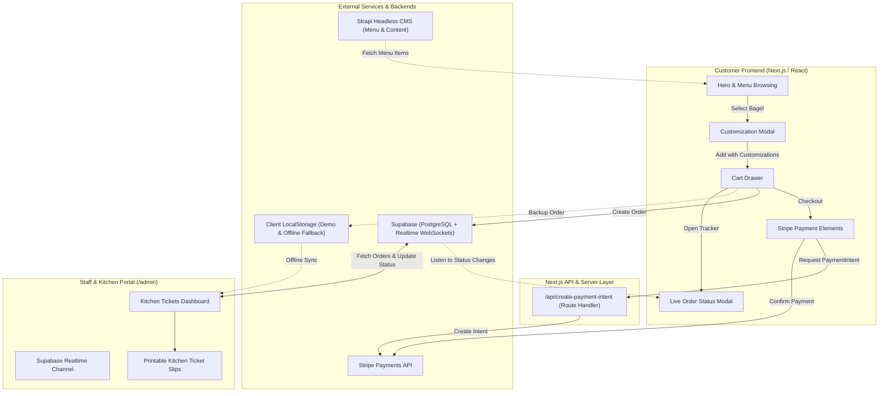

# 🥯 Bagelicious Bagel Shop

A modern, full-stack web application for an artisanal New York-style bagel shop built with **Next.js 14+ (App Router)**, **TypeScript**, **Tailwind CSS**, **Stripe Checkout**, **Supabase (PostgreSQL & Realtime)**, and **Strapi CMS**.

---

## 📖 Table of Contents
1. [Project Overview](#-project-overview)
2. [System Architecture](#-system-architecture)
3. [Core Logic & How It Works](#-core-logic--how-it-works)
   - [1. Menu Browsing & Customization](#1-menu-browsing--customization)
   - [2. Cart & Order Calculation](#2-cart--order-calculation)
   - [3. Payment Processing (Stripe)](#3-payment-processing-stripe)
   - [4. Order Persistence & State Machine](#4-order-persistence--state-machine)
   - [5. Realtime Order Tracking for Customers](#5-realtime-order-tracking-for-customers)
   - [6. Kitchen & Staff Admin Dashboard (`/admin`)](#6-kitchen--staff-admin-dashboard-admin)
4. [Roles of Strapi vs. Supabase vs. Fallback Mode](#-roles-of-strapi-vs-supabase-vs-fallback-mode)
5. [Directory & Component Structure](#-directory--component-structure)
6. [Environment Variables](#-environment-variables)
7. [Getting Started (Local Development)](#-getting-started-local-development)
8. [Production Deployment](#-production-deployment)

---

## 🌟 Project Overview

**Bagelicious Bagel Shop** provides a seamless, end-to-end digital ordering experience for both bagel lovers and kitchen staff:

- **Customer Front-End**:
  - Live menu with category filters and search.
  - Interactive bagel customizer modal: bread options, toasting levels (*Not Toasted*, *Lightly Toasted*, *Well Done*, *Scooped*), cream cheese pairings, quantities, and special preparation notes.
  - Slide-over cart drawer with pricing breakdown (sales tax, estimated preparation times).
  - Stripe payment processing (with credit card validation, test card shortcuts, and counter-pickup cash fallback).
  - Real-time customer order tracking modal (`BGL-XXXXXX`).
- **Kitchen & Staff Back-Office (`/admin`)**:
  - Pin-protected kitchen operations console.
  - Order progression workflow: **Received** (`pending`) ➔ **In Oven** (`preparing`) ➔ **Ready** (`ready`) ➔ **Completed** (`completed`).
  - Audio chimes for incoming tickets.
  - Detailed kitchen preparation tickets: interactive checkbox checklists for line cooks, highlighted toasting styles, schmear callouts, and customer packaging notes.
  - Printable kitchen prep slips for counter tickets.

---

## 🏗️ System Architecture



---

## ⚙️ Core Logic & How It Works

### 1. Menu Browsing & Customization
- **Catalog Loading**: `app/page.tsx` fetches bagels and cream cheeses on initial load. It first queries Strapi (`getBagelsFromStrapi`) or Supabase (`getBagelsFromSupabase`). If no backend is reachable, it smoothly falls back to the curated menu dataset in `lib/menuData.ts`.
- **Item Customization** (`components/CustomizationModal.tsx`):
  - Customers customize each bagel before adding it to their cart.
  - Configurable properties:
    - **Bread Option**: Standard Sliced, Flat / Flagel, Gluten-Free (+ $1.00).
    - **Toasting**: *Not Toasted*, *Lightly Toasted*, *Well Done*, or *Scooped Out*.
    - **Cream Cheese / Spreads**: Plain, Scallion, Lox Spread, Jalapeño Cheddar, Vegan Tofu, Butter, Jam, or None.
    - **Special Instructions**: Allergy notes, extra crispy crust, packaging requests.

### 2. Cart & Order Calculation
- **State Management**: Cart state lives in `app/page.tsx` as `cartItems: CartItem[]`.
- **Deduplication & Item Identification**: Items in the cart receive a unique `cartId`. If an item with the identical bagel, cream cheese, toasting level, and notes is added again, its quantity is incremented rather than duplicating lines.
- **Financial Calculations**:
  - `subtotal`: Sum of `(bagel.price + creamCheese.price) * quantity`.
  - `tax`: New York State sales tax (8.875%).
  - `total`: Calculated in cents for Stripe compatibility (`Math.round(total * 100)`).

### 3. Payment Processing (Stripe)
- When checkout begins, the client requests a `PaymentIntent` via `POST /api/create-payment-intent`.
- Next.js server validates the payload, initializes the Stripe client using `STRIPE_SECRET_KEY`, and returns a `clientSecret`.
- `components/StripePaymentSection.tsx` mounts the Stripe `@stripe/react-stripe-js` `<PaymentElement />`.
- Once confirmed by Stripe, the order is flagged as `paid` and the Stripe PaymentIntent ID (`pi_...`) is attached to the ticket metadata.

### 4. Order Persistence & State Machine
Every order follows a strict 4-step state lifecycle:

| Status | Customer Label | Kitchen Action |
|---|---|---|
| `pending` | **Order Received** | Order arrives in kitchen with audio chime; waiting in queue. |
| `preparing` | **In the Oven** | Baker begins slicing, schmearing, and toasting bagels. |
| `ready` | **Ready for Pickup** | Bagged and labeled at pickup counter (142 Bleecker St). |
| `completed` | **Order Completed** | Handed to customer; ticket moved to kitchen history. |

- **Storage**:
  - Primary: Written to the Supabase `orders` PostgreSQL table with columns: `order_number`, `customer_name`, `email`, `phone`, `pickup_time`, `items` (JSONB), `total_amount`, and `status`.
  - Secondary/Fallback: Stored in `localStorage` (`bagel_shop_recent_orders`) so customers and kitchen staff can test full workflows even without an active internet database connection.

### 5. Realtime Order Tracking for Customers
- When an order completes, `components/OrderStatusModal.tsx` opens.
- It initiates a **Supabase Realtime Channel**:
  ```ts
  supabase
    .channel(`order-sync-${order.orderNumber}`)
    .on('postgres_changes', {
      event: 'UPDATE',
      schema: 'public',
      table: 'orders',
      filter: `order_number=eq.${order.orderNumber}`
    }, (payload) => {
      setCurrentStatus(payload.new.status);
    })
    .subscribe();
  ```
- **Redundant Polling & Storage Sync**: In addition to WebSockets, the modal listens to `window.storage` events and polls every 3 seconds, ensuring status transitions update instantly regardless of browser or network limitations.

### 6. Kitchen & Staff Admin Dashboard (`/admin`)
- Accessible at `/admin` (with staff PIN protection, e.g. `bagel2026`).
- **Kitchen Ticket View**:
  - Displays pending tickets in chronological order.
  - Interactive preparation checklist: line cooks can click individual items to check them off as each bagel is prepared.
  - Audio alert (`Web Audio API` chime) triggers when new orders arrive.
  - Status progression buttons: Single-click moves ticket from `pending` ➔ `preparing` ➔ `ready` ➔ `completed`.
  - **Print Slip**: Formatted layout for physical thermal or paper kitchen receipts (`window.print()`).

---

## 🗄️ Roles of Strapi vs. Supabase vs. Fallback Mode

This application is built with a resilient, decoupled backend architecture:

| System | Role | Primary Data Managed |
|---|---|---|
| **Strapi CMS** | Headless Content Management | **Store Menu & Content**: Bagel descriptions, prices, cream cheese catalog, categories, calorie counts, and promotional banners. Non-technical staff can update menu items here without redeploying code. |
| **Supabase** | Backend-as-a-Service & Database | **Transactional Order Data & Realtime**: Customer orders, payments, order lifecycle state, and PostgreSQL Realtime subscriptions (`postgres_changes`) for instant sync between the kitchen and customer screens. |
| **Local Fallback Mode** | Zero-Config Development & Demos | **Local Storage & Mock Data**: If neither Strapi nor Supabase is configured, the application runs entirely in demo mode using `lib/menuData.ts` and `localStorage`, providing a 100% functional demo without any external setup. |

---

## 📁 Directory & Component Structure

```
bagel-shop/
├── app/
│   ├── layout.tsx                     # Root layout, Google Geist fonts, meta tags
│   ├── page.tsx                       # Main storefront page (hero, menu, cart state)
│   ├── globals.css                    # Tailwind CSS directives & theme styles
│   ├── admin/
│   │   └── page.tsx                   # Kitchen staff operations dashboard & tickets
│   └── api/
│       └── create-payment-intent/
│           └── route.ts               # Stripe PaymentIntent creation endpoint
├── components/
│   ├── Navbar.tsx                     # Sticky top bar, cart badge, track order button
│   ├── Hero.tsx                       # Hero section with CTA & features
│   ├── MenuSection.tsx                # Menu categories, search filter, bagel grid
│   ├── BagelCard.tsx                  # Individual bagel card with price & customization trigger
│   ├── CustomizationModal.tsx         # Bagel customizer (bread, toast, cream cheese)
│   ├── CartDrawer.tsx                 # Sliding cart drawer with checkout flow
│   ├── StripePaymentSection.tsx       # Stripe Elements card checkout & test helper
│   ├── OrderStatusModal.tsx           # Live order status tracker for customer
│   └── TrackOrderModal.tsx            # Order number lookup popup (e.g. BGL-123456)
├── lib/
│   ├── menuData.ts                    # Full mock catalog of bagels, categories, and spreads
│   ├── strapi.ts                      # Strapi REST client & fallbacks
│   └── supabase.ts                    # Supabase browser client, CRUD helpers, realtime sync
└── types/
    └── bagel.ts                       # Shared TypeScript models (Bagel, CartItem, Order, etc.)
```

---

## 🔑 Environment Variables

To run with full live integrations (Stripe + Supabase + Strapi), create a `.env.local` file in the root directory:

```env
# ----------------------------------------------------
# STRIPE PAYMENTS
# ----------------------------------------------------
# Public key for Stripe Elements in the browser
NEXT_PUBLIC_STRIPE_PUBLISHABLE_KEY=your_stripe_publishable_key_here

# Secret key for server-side PaymentIntent creation
STRIPE_SECRET_KEY=your_stripe_secret_key_here

# ----------------------------------------------------
# SUPABASE (Orders & Realtime Sync)
# ----------------------------------------------------
# Found in Supabase Dashboard -> Project Settings -> API
NEXT_PUBLIC_SUPABASE_URL=https://your-project.supabase.co
NEXT_PUBLIC_SUPABASE_ANON_KEY=eyJhbGciOi...

# ----------------------------------------------------
# STRAPI CMS (Optional Menu Content Provider)
# ----------------------------------------------------
NEXT_PUBLIC_STRAPI_URL=http://localhost:1337
```

> **Note**: If any environment variables are omitted, the application automatically runs in **Demo Mode**, allowing complete end-to-end testing without external services.

---

## 🚀 Getting Started (Local Development)

### 1. Clone & Install Dependencies
```bash
git clone https://github.com/your-username/bagel-shop.git
cd bagel-shop
npm install
```

### 2. Configure Environment Variables
Copy the sample environment variables into `.env.local`:
```bash
cp .env.example .env.local  # or create .env.local with your keys
```

### 3. Start the Next.js Development Server
```bash
npm run dev
```
Open [http://localhost:3000](http://localhost:3000) in your browser.

### 4. Exploring the App
- **Storefront**: [http://localhost:3000](http://localhost:3000)
- **Kitchen Admin Dashboard**: [http://localhost:3000/admin](http://localhost:3000/admin) (Sign in with PIN `bagel2026`)
- **Simulating an Order**:
  1. Add a customized bagel to your cart.
  2. Open the cart and proceed to checkout.
  3. Enter customer info, pay via Stripe (or demo card), and submit.
  4. Notice the `BGL-XXXXXX` tracking modal appear.
  5. Open `/admin` in a second tab/window to watch the order arrive in realtime, check off items, and update its status.

---

## 🚢 Production Deployment

### Recommended: Deploying on Vercel
1. Push your repository to GitHub / GitLab.
2. Go to [Vercel](https://vercel.com) and click **"New Project"** -> Import your repository.
3. In **Environment Variables**, add:
   - `NEXT_PUBLIC_STRIPE_PUBLISHABLE_KEY`
   - `STRIPE_SECRET_KEY`
   - `NEXT_PUBLIC_SUPABASE_URL`
   - `NEXT_PUBLIC_SUPABASE_ANON_KEY`
4. Deploy! Vercel will build and serve your Next.js application with automatic edge routing and API routes.

---

## 📄 License
This project is open-source and available under the [MIT License](LICENSE).
